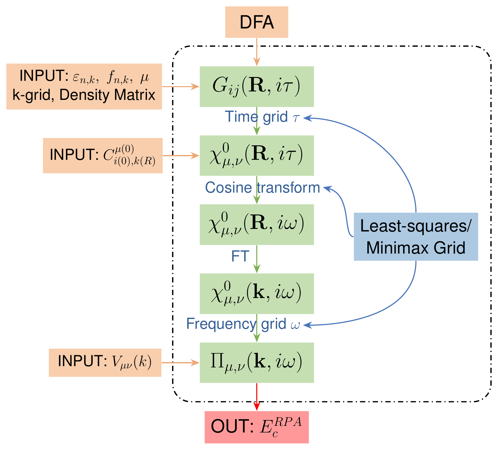
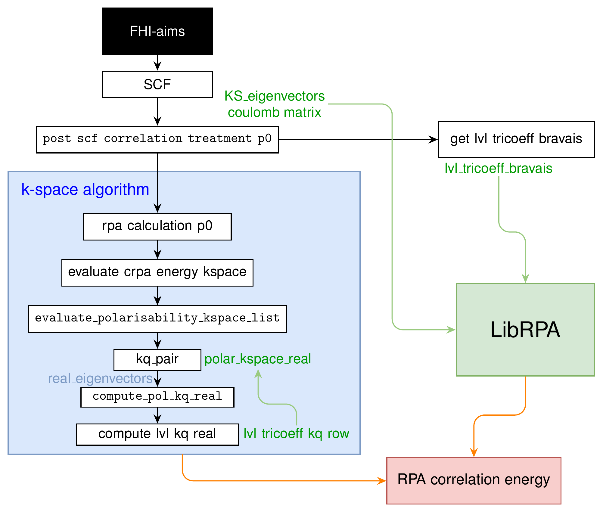
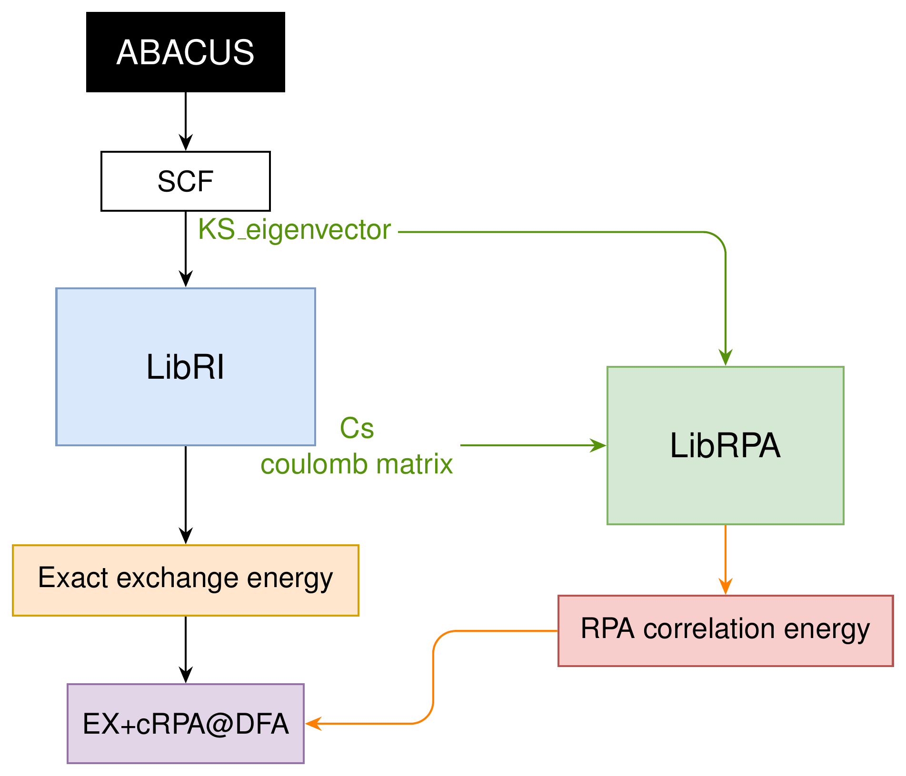

# Code Design

LibRPA is designed to provide efficient and scalable implementations of various beyond-DFT methods, including but not limited to random-phase approximation (RPA) correlation energies. The library is developed in C++ and Python, utilizing a hybrid parallelism model with MPI and OpenMP to maximize performance on modern high-performance computing systems.

## Framework of RPA calculation

## RPA interface to FHI-aims

## RPA interface to ABACUS

## QSGW task boundary

The new QSGW iteration, restart state, live optical updates and diagnostic results
are implemented in `src/core/qsgw/`. The public API separates runtime controls
in `librpa_options.h`, numerical input and its setter in `librpa_input.h`, and
task execution and output callbacks in `librpa_compute.h`. The driver reads
host files and writes the returned output events.

The existing `src/api/Dataset` ownership and G0W0 workflow remain in place.
QSGW borrows only the numerical objects it uses through its own `TaskContext`;
the API task retains the original dataset for the borrowed references' lifetime.
Initialization and the existing G0W0 Sigma build are supplied by API adapters.
The optional response observer runs at the resident full-response boundary so a
companion task can consume that response before screening releases it. Core QSGW
code includes no API or driver header. Its entering-state QP diagnostic and table
formatters belong to QSGW and preserve the existing continuation options and
output conventions.

## QSGW iteration state and checkpoints

Checkpoint state, serialization and input comparison live in
`src/core/qsgw/checkpoint`. For filenames, switches and continuation examples,
see the [QSGW user guide](../user_guide/qsgw.md#checkpoint-continuation).
The source-only note `docs/theory/qsgw/staticization.md` describes the self-energy map.

### Reference state and saved payload

Keep the original DFT reference immutable throughout a run and its
continuations. Current Hamiltonians are represented in that initial KS
basis; current eigenvalues and wavefunctions describe the updated states.
Restoring the saved wavefunctions directly preserves their phases and
degenerate-subspace frame at the restart boundary.

| Payload | Contents and purpose |
| --- | --- |
| Input reference | Grid reference eigenpairs, occupation weights, Fermi energy and DFT Vxc; grid/path k coordinates and grid weights. These bind the saved state to the initial basis and input. |
| Live state | Current reference-basis Hamiltonian, eigenvalues, complex wavefunctions, occupation weights and Fermi energy. Dimensions include spin, spinor, k point, band and AO counts. |
| Iteration summary | Completed iteration number, maximum eigenvalue change, Hamiltonian residual norms, Fermi energy, gap, electron count, effective mixing fraction and convergence flag. |
| Update settings | Cut mode, retained unoccupied count, shift, effective mixing fraction, frequency count and head mode. |
| Optional band channel | Band reference and Vxc, current band Hamiltonian and live eigenpairs/occupations. Its presence and original path must agree on continuation. |
| Live head/wing context | With active `current_hr`, native DFT H(R), S(R), r(R), lattice and mesh; with active `rotate_reference`, the immutable reference velocity matrices. |

Immutable reference operators are stored for comparison with freshly loaded
inputs. They do not replace the original input dataset. RI coefficients,
Coulomb matrices, frequency-dependent self-energy and screened interaction
are not serialized here; exchange and screening are rebuilt for the next
update. This format has no adaptive-mixer history.

The reader checks the numerical context above, including localized R support,
and compares real/imaginary entries with an absolute `1e-12` tolerance. It
does not check every producer file or numerical option: for example, Padé
controls and arbitrary RI/Coulomb changes are not covered by
`CheckpointContext`. Retain those inputs and controls unchanged as well.

### Completed updates and MPI restoration

The publication points have different meanings:

1. Optional HR export writes the actual mixed/post-cut Hamiltonian before
   diagonalization. An HR snapshot alone does not certify a completed update.
2. After diagonalization and occupation updates succeed, root writes the
   completed state to `<checkpoint>.tmp`, flushes and closes it, then renames
   it to the selected checkpoint filename. A later interrupted update leaves
   the preceding completed checkpoint available.
3. Text iteration/eigenvalue traces and optional band tables are written
   after the checkpoint. They are not part of the checkpoint's atomic rename;
   an output failure can leave a valid checkpoint without all corresponding
   text records.

Checkpoint file operations are root-only. On restore, reference checks,
payload reads and trailing-data checks finish before the temporary restored
state replaces the live state. `collective_root_stage` communicates failure
before any dependent state broadcast. On success, the numerical task broadcasts the
completed iteration number, live mean field and Hamiltonian, including the
band channel when present.

No MPI process partition is serialized. Continuation can change rank count
within the supported route, which requires complete replicated wavefunctions
on every rank. The next update rebuilds its compute objects from the restored
state. Work inside an unfinished self-energy calculation is not resumed.

### Binary format and numerical validation

This is an experimental native-binary format. Its magic string, version,
byte-order marker and velocity tags describe the serialization convention;
they are not content hashes or a portable interchange schema. Incompatible
byte order is rejected.

The writer currently selects versions as follows:

| Active velocity convention | No cut | Shifted cut mode 1 |
| --- | --- | --- |
| No live-velocity context, including legacy `reference` | 3 | 8 |
| `rotate_reference` | 5 | 9 |
| Native-baseline `current_hr` | 10 | 11 |

With Hartree feedback enabled, the writer adds 200 to the version selected
above (for example, 208 for the shifted-cut reference-velocity map). The
additional context binds the dedicated bare q=0 metric, unwrapped LRI
coefficients, BvK convention and actual atom-pair image mapping, as well as
the feedback switch. Restore rejects a change in this context. Earlier +100
checkpoints used the direct-R Hartree path and require a fresh start. The
original DFT density is reconstructed from the immutable input reference before restoring the live state; it is never reset to the
checkpoint density. See the [Hartree guide](../user_guide/hartree.md).

Legacy versions 1--3 are readable only when their update context still agrees.
Version 4 belongs to another equation/mixer branch; versions 6/7 use the
historical cut convention and are rejected. Versions 5/9 that encode the old
whole-H current-HR map cannot be continued as native-baseline versions 10/11.
Do not reinterpret a prior payload or silently change its physical map when
extending the format. Update both reader and writer, select an explicit
compatible version or reject the old convention, and document the boundary.

Use `regression_tests/verification/verify_qsgw_restart.py` for continuous versus split-run
numerical comparisons. The restored boundary must agree exactly; subsequent
fixed-reference operators and eigenvalues use the existing numerical gates.
Later eigenvector phases or degenerate frames can differ between independent
runs. `regression_tests/verification/verify_qsgw_headwing.py` therefore aligns the entering
eigenframes before comparing velocity and also compares head/wing feedback
and frequency nodes. Both scripts require NumPy, the matching MPI runtime
and a Python version with `tarfile` extraction filters, such as Python 3.12+.

For changes to native reconstruction, retain the finite-metric, native-tail
and SOC numerical controls in `test_rpa_headwing`. These checks establish
implementation consistency; they do not establish material convergence.

## cRPA task boundary

The cRPA numerical workflow and its optional QSGW companion live in
`src/core/crpa_task` and `src/core/crpa_qsgw_extension`. They borrow the loaded
mean fields and screening data through `CrpaTaskContext`; the API retains the
original Dataset ownership and supplies its existing initialization operations.
The companion consumes the resident response and owns parent-frame transport
and checkpoint companions. Its result callback is for output only. The driver
reads host files and presents public result snapshots.
